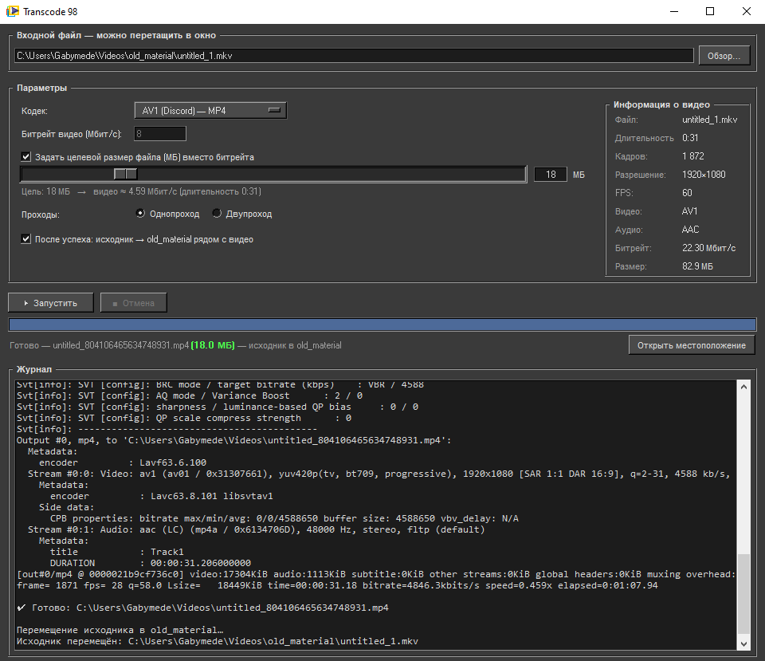

# Transcode 98

Минималистичный GUI для ffmpeg в стиле Win98 (тёмная тема).
Перекодирует видео в AV1 / VP9 / HEVC с возможностью задать целевой размер файла.

   <!-- опционально, позже -->

## Возможности

- Кодеки: AV1 (libsvtav1), VP9 (libvpx-vp9), HEVC (libx265)
- Два режима качества: фиксированный битрейт / CRF либо целевой размер файла (МБ)
- Одно- и двухпроходное кодирование
- Прогресс в строке заголовка, на панели задач и в статус-баре
- Drag & drop файлов, вставка из буфера обмена (Ctrl+V)
- После успешного кодирования исходник можно автоматически переместить в `old_material/`

## Быстрый старт (Windows)

Из исходников — нужны Python 3.12 и FFmpeg:

```powershell
# Автоматическая установка зависимостей (Python, FFmpeg, tkinterdnd2)
powershell -ExecutionPolicy Bypass -File .\install_all.ps1

# Запуск
py -3.12 Transcode.py