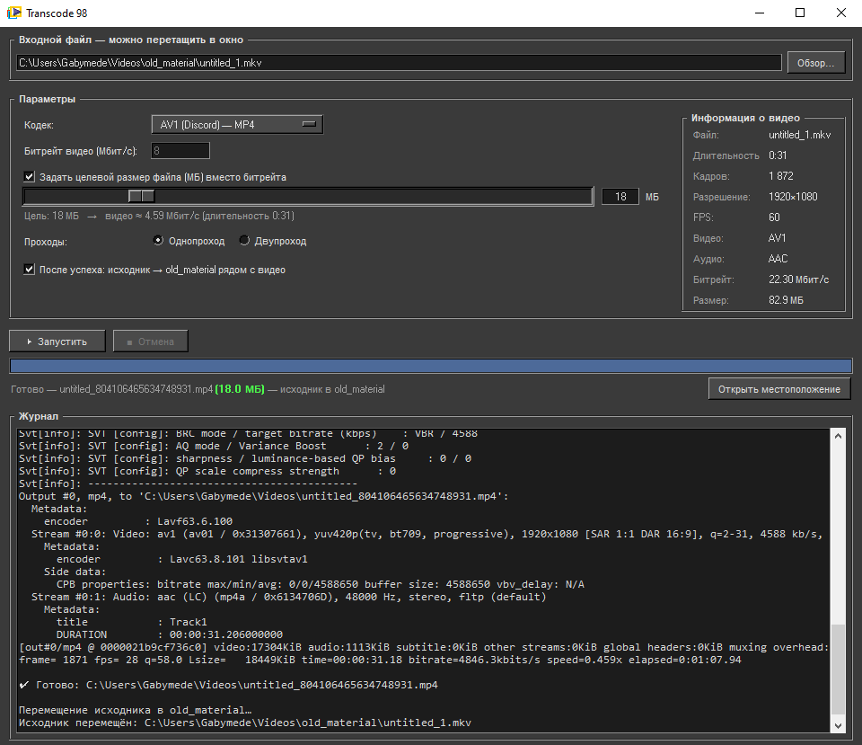

# Transcode 98

Минималистичный GUI для FFmpeg.
Перекодирует видео в AV1 / VP9 / HEVC / H.264 с возможностью задать целевой размер файла.
Этот проект на 99% состоит из кода DeepSeek. Остальной 1% произведен мною. Дизайн интерфейса, подбор кодеков и параметров транскода.



## Возможности

- Кодеки: AV1 (libsvtav1), VP9 (libvpx-vp9), HEVC (libx265), H.264 (libx264) — и любые другие, добавленные пользователем
- **Пользовательские конфигурации транскода**: добавление из готовых шаблонов, редактирование, дублирование и удаление через кнопку «Настройки…»
- Два режима качества: фиксированный битрейт/CRF либо целевой размер файла задаваемый в МегаБайтах
- Одно- и двупроходное кодирование (двупроход — для битрейта или целевого размера; отключается для CRF, GPU и расширенного лога)
- **Рескейлинг**: изменение разрешения (по высоте, с сохранением пропорций или без)
- **Понижение FPS**: даунгрейд частоты кадров до заданного значения (меньше исходного)
- Прогресс в строке заголовка, на панели задач и в статус-баре
- Drag & drop файлов, вставка из буфера обмена (Ctrl+V)
- После успешного кодирования исходник можно автоматически переместить в `old_material/`, которая автоматически создается в директории нахождения исходника
- Быстрый анализ данных файла через ffprobe (включая **битрейт аудиопотока**; для MKV, где контейнер не хранит per-stream bitrate, значение оценивается по размеру пакетов и длительности)

## Конфигурации транскода

Помимо встроенных пресетов (AV1 / VP9 / HEVC / H.264), можно создавать свои.
Пресет выбирается в главном окне в поле **«Конфигурация:»**, рядом — кнопка
**«Настройки…»**, где пресеты создаются, редактируются и сохраняются.

### Быстрое добавление варианта

Кнопка **«Добавить ▾»** открывает готовые шаблоны:

- **H.264 (x264)** — максимальная совместимость;
- **H.265 / HEVC (x265)** — меньше файл при том же качестве;
- **AV1 (SVT-AV1)** — минимальный размер;
- **VP9** — WebM для YouTube;
- **Пустая конфигурация** — для ручной настройки.

Шаблон сразу заполняет кодек, контейнер, качество, скорость и аудио.
Дальше достаточно поправить качество и нажать «Сохранить».

Конфигурацию можно удалить кнопкой **«Удалить»** или клавишей **Del**
при выбранном элементе списка (удаление подтверждается).

### Редактор

В обычном режиме видны только основные поля:

| Поле | Описание |
|------|----------|
| Название | Отображается в списке конфигураций; можно менять и при включённом расширенном логе |
| Видео-кодек | Имя кодека ffmpeg (`libsvtav1`, `libvpx-vp9`, `libx265`, `libx264`, `h264_nvenc` …). Кнопка ▾ предлагает готовые варианты; можно ввести и любой другой кодек вручную |
| Контейнер | Расширение выходного файла без точки (`mp4`, `webm`, `mkv` …) |
| Бэкенд | `CPU` или `GPU`; для GPU CPU-кодек заменяется аппаратным аналогом (NVENC) |
| Режим | `Постоянное качество (CRF)` или `Битрейт (Мбит/с)` |
| Качество по умолч. | Значение по умолчанию для поля качества в главном окне |
| Скорость | Пресет кодека. Кнопка ▾ показывает понятные варианты (Быстро / Обычно / Медленно …) |
| Двупроход | Разрешить двухпроходное кодирование (только для битрейта) |

Редкие параметры спрятаны под галочкой **«Показать дополнительные
параметры»**:

| Поле | Описание |
|------|----------|
| GOP | Интервал ключевых кадров (0 — не задавать) |
| Пресет 1-го прохода | Переопределяет пресет в первом проходе; пусто — используется основной пресет |
| Пресет 2-го прохода | Переопределяет пресет во втором проходе; пусто — используется основной пресет |
| Доп. видео-аргументы | Через пробел, например `-pix_fmt yuv420p -row-mt 1` |
| Аудио-кодек | `copy` — без перекодирования, либо `libopus`, `aac` … |
| Доп. аудио-аргументы | Через пробел, например `-b:a 192k -ar 48000` |
| Произвольные аргументы ffmpeg | Вставляются как есть перед выходным файлом — полный ручной контроль (`-tune film`, `-movflags +faststart`, `-max_muxing_queue_size 1024` и т.п.) |
| Расширенный лог | Готовая команда ffmpeg; при заполнении полностью заменяет параметры редактора |

Форма редактора прокручивается: все поля доступны даже на невысоком экране.

Настройки сохраняются в `configs.json` рядом с приложением (portable) либо,
если папка недоступна для записи, — в `%APPDATA%\Transcode98\configs.json`.
Если файл отсутствует или повреждён, используются встроенные пресеты.

### Опции GUI

В окне «Настройки» есть блок **«Опции GUI»** — он определяет, какие блоки
показывать в главном окне:

- **Рескейлинг** — галочка и параметры изменения разрешения;
- **Понижение частоты кадров (FPS)** — галочка и параметры FPS;
- **Сводка ffprobe** — панель «Информация о видео»;
- **Журнал выполнения** — нижняя панель с логом ffmpeg.

Скрытые блоки не участвуют в сборке команды ffmpeg.

### Качество и скорость

- **CRF** — постоянное качество: меньше значение — лучше картинка и больше файл.
  Для H.264/H.265 диапазон 0–51, для AV1/VP9 — 0–63. Ориентиры: 20–28 для
  H.264/H.265 и 28–35 для AV1/VP9.
- **Битрейт** — фиксированная скорость в Мбит/с. Для небольших файлов
  включите двухпроход: он точнее распределяет биты между сложными сценами.
- **Скорость** — компромисс между временем кодирования и сжатием. Чем
  медленнее пресет, тем меньше файл при том же качестве. Для AV1 и VP9
  меньшее число означает более медленное и качественное кодирование.
  Если значение не подходит выбранному кодеку, под полем появляется
  красное предупреждение.

### Расширенный лог

Если включить «Использовать расширенный лог», команда ffmpeg собирается из
указанной строки, а поля редактора (кодек, качество, скорость, GOP, аргументы,
двупроход) игнорируются. Название конфигурации при этом остаётся доступным.

Поддерживаются подстановки `{input}`, `{output}` и `{ext}`. Вход всегда
передаётся первым: если в строке нет `-i`, приложение добавит его само.
Поэтому корректный пример выглядит так:

```
ffmpeg -i {input} -c:v libx264 -crf 20 -preset slow {output}
```

Строку можно писать и без `ffmpeg -y` — они добавляются автоматически.

Старые версии записывали готовый расширенный лог прямо во встроенные пресеты.
При загрузке такие устаревшие значения автоматически очищаются, чтобы снова
работали поля редактора и настройки главного окна.

### Ограничения двухпрохода

Двупроходное кодирование включается галочкой в конфигурации и переключателем
«Двупроход» в главном окне, но автоматически отключается, когда оно не даёт
результата:

- в режиме **CRF** без целевого размера (статистика первого прохода не используется);
- для **GPU-кодеков** (NVENC);
- при включённом **расширенном логе**.

Для целевого размера файла двухпроход по-прежнему работает.

## Рескейлинг и понижение FPS

В блоке «Параметры» есть две независимые опции. Их настройки появляются
в отдельном боксе **«Параметры функций»** только тогда, когда опция включена:

- **Рескейлинг** — задайте целевую высоту в пикселях. При включённой галочке
  «Сохранять пропорции» ширина пересчитывается автоматически (кратно 2).
  Под полем показывается предпросмотр вида `1920×1080 → 1280×720`.
- **Понизить частоту кадров (FPS)** — задайте целевой FPS. Значение должно быть
  меньше исходного; рядом показывается FPS исходника.

Обе опции применяются через `-vf scale=…` и `-r …` соответственно и работают
с любой конфигурацией, кроме расширенного лога: он задаёт команду целиком,
поэтому рескейлинг и FPS в этом режиме игнорируются (об этом пишется в журнале).

## Особенности и параметры кодирования

По умолчанию используются программные (CPU) энкодеры FFmpeg — они дают
наилучшее качество сжатия. Для конфигурации можно выбрать бэкенд **GPU**:
тогда CPU-кодек заменяется аппаратным аналогом NVENC (`libx264` → `h264_nvenc`,
`libx265` → `hevc_nvenc`, `libsvtav1` → `av1_nvenc`). У VP9 аппаратного аналога
нет, поэтому `libvpx-vp9` всегда остаётся программным.

### AV1 (libsvtav1)
- **Режим:** CRF (в шаблоне — 30) либо VBR/целевой размер файла (встроенный пресет Discord).
- **Скорость:** 8 для шаблона; встроенный пресет использует 4 для однопрохода, 8 (анализ) и 2 (финал) для двухпрохода. Пресеты проходов можно переопределить в дополнительных параметрах.
- **GOP (Keyframe interval):** 30 кадров.
- **Пиксельный формат:** yuv420p.
- **Аудио:** Копируется без перекодирования (copy).

### VP9 (libvpx-vp9)
- **Режим:** CRF (в шаблоне — 32) либо VBR с жёстким ограничением (maxrate и bufsize 24M).
- **Оптимизация:** Включен многопоточный анализ рядов (row-mt 1), разделение на колонки (tile-columns 2) и баланс скорости/качества (cpu-used 4).
- **GOP:** 30 кадров.
- **Аудио:** Перекодируется в libopus (битрейт 192 kbps, 48 кГц).
- **GPU:** не поддерживается — аппаратного аналога VP9 нет.

### HEVC (libx265)
- **Режим 1 (CRF):** Постоянный уровень качества (0–51; в шаблоне 24, во встроенном пресете 23). Двухпроходное кодирование отключено.
- **Режим 2 (Целевой размер):** VBR (битрейт) с возможностью двухпрохода (через -x265-params pass=1/2).
- **Скорость:** medium (баланс скорости и эффективности).
- **GOP:** 30 кадров.
- **Аудио:** Копируется без перекодирования (copy).

## Установка

### Для пользователей Win10/11
Скачивать Python или FFmpeg отдельно **не нужно** — все зависимости уже встроены в установщик.

1. Перейдите в раздел [Releases](https://github.com/Gabymede/Transcode98/releases).
2. Скачайте файл `Transcode98_Setup.exe`.
3. Запустите установщик и следуйте инструкциям.

### Для пользователей Linux
Скачивать Python или FFmpeg не нужно, они уже внутри.

1. Перейдите в раздел [Releases](https://github.com/Gabymede/Transcode98/releases).
2. Скачайте файл `Transcode98_Linux_x86_64.tar.gz`.
3. Распакуйте архив в удобную папку:
   ```bash
   tar -xzf Transcode98_Linux_x86_64.tar.gz -C ~/Transcode98
   ```
4. Запустите приложение:
   ```bash
   cd ~/Transcode98
   ./Transcode98
   ```


## Лицензия

Этот проект распространяется под лицензией [GPL-3.0](LICENSE).
